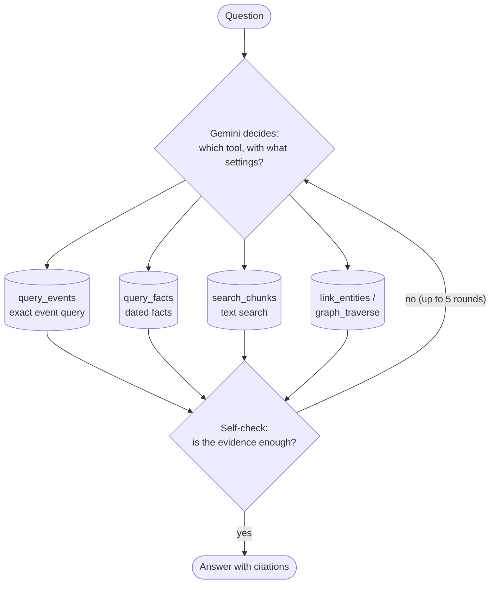

# 5 · Agentic GraphRAG: the submitted approach

In one sentence

An AI agent with five tools (exact event queries, dated-fact queries, entity lookup, link-following and text search) that picks a tool, checks its own evidence, and switches strategy when the first try fails.

The team calls it "the Investigator" in code · 99% · about 3,400 tokens, 2 Gemini calls and 13 seconds per question

**Analogy:** a research assistant who has the spreadsheet *and* the library, knows when to use which, and double-checks before answering.

## What makes it "agentic"

A fixed recipe ([approaches 1, 2 and 4](index.md#2-fixed-recipe-vs-agent)) runs the same steps every time. This approach lets Gemini **decide each next step**:

Each round is **one Gemini call** that returns a structured decision: the tool, its settings, a short reason, and a self-check of the evidence so far. The code runs the tool against TigerGraph, adds the results to the evidence (each item tagged with its source article and the exact query that produced it), and asks again.

## Example 1: the usual case, two rounds

> **"Who won gold at Richmond Olympic Oval on 14 February 2010?"** *(Our live run.)*

| Round | Gemini's decision | What happened |
|---|---|---|
| 1 | `query_events`: operation `gold_at_venue_date`, venue *Richmond Olympic Oval*, date *14 February 2010* | TigerGraph returns the 10 events at that venue; one matches the date: Women's 3000 m, gold **Martina Sáblíková** [Q580481] |
| 2 | `answer`. Self-check: *"The evidence [Q580481] directly identifies Martina Sáblíková as the gold medalist."* | **Martina Sáblíková** ✓ |

2 Gemini calls, 1 TigerGraph query, about 8 seconds.

## Example 2: the first try fails, and it recovers

> **"Who won the gold medal in the event held at Estadi Olímpic Lluís Companys, Barcelona on August 9 at the 1992 Summer Olympics?"** *(Our benchmark run, unedited.)*

| Round | Gemini's decision | What happened |
|---|---|---|
| 1 | `query_events`: `gold_at_venue_date`, venue *Estadi Olímpic Lluís Companys*, date *August 9* | **No matching events.** The date was stored in a different form. |
| 2 | `search_chunks` for *"Estadi Olímpic Lluís Companys August 9 1992 gold medal"*. Reason: *"The structured query returned no results, likely because the date format… varies."* | Passages about athletics at that stadium, but none clearly on August 9 |
| 3 | `search_chunks` again, reworded. Self-check: *"[Q733026] covers athletics but not August 9… No event on August 9 is established."* | Finds the men's marathon article |
| 4 | `answer`. Self-check: *"[Q1407627] explicitly states the Men's marathon was held at Estadi Olímpic… on August 9, 1992."* | **Hwang Young-Cho** ✓ |

Nobody programmed "if the date lookup fails, rephrase and search the text". The agent decided that itself. **That is the difference from the event graph's fixed recipe.**

## How agentic is it in practice?

Across our run of the 100 public questions:

| Behaviour | Count |
|---|---:|
| Chose the exact event query first | 100 / 100 |
| Answered after 2 rounds (query → answer) | 93 |
| Needed text search as a backup, like Example 2 | 7 |
| Ran out of rounds | 0 |

So its main job is **choosing the right tool and filling in the right settings**, and recovering when that fails. The exact query does the heavy lifting; the agent adds flexibility for questions the operations don't cover.

!!! warning "Judgment can cut both ways"
    On the 2008 fencing question, the graph said the men's épée had **41,000,000** competitors, an error copied from the source article. In our run, the agent decided that was a data error, discarded it and answered the next-largest event. That is sensible reasoning, but it is marked wrong, because the official answer follows the article as written. The team's run trusted the number and was marked right. This one question is the whole gap between our 98 and their 99.

!!! info "A bug the team found and fixed"
    To keep prompts small, at most 12 events are shown back to the agent. An early version then *recounted* those 12 instead of reading the total the tool had already computed, so several counting answers came out as exactly "12". The fix gives the agent the computed total. A regression test now guards it, and our hidden-set answers are free of it.

## Numbers

| | Submitted | Our rerun |
|---|---:|---:|
| Exact match | 99 / 100 | 98 / 100 |
| Gemini calls per question | 2.1 | 2.0 |
| Tokens per question | 3,412 | 3,575 |
| Seconds per question | 13.2 | 13.2 |
| Paraphrased questions (10, reworded by the team) | 10 / 10 | 10 / 10 |
| Hidden set: same answer as the submission | — | 49 / 50 (the one difference is the word "and") |

It costs about the same as plain search (3,400 vs 3,600 tokens), for 99% instead of 67%.

Code: `src/pipelines/investigator/pipeline.py`
