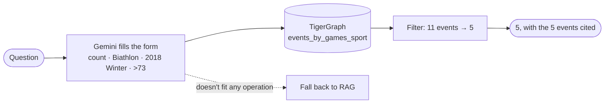

# 4 · Event graph: one exact query

In one sentence

Gemini translates the question into a small typed form, TigerGraph runs one exact query over the structured event records, and the answer is filled in from the matching records.

A fixed recipe on structured data · 99% · about 600 tokens, 1 Gemini call and 7–9 seconds per question

**Analogy:** instead of reading articles, you open a spreadsheet with one row per Olympic event and use the filter button.

## How it works

<ol class="rv-steps">
<li><b>Fill in the form (1 Gemini call).</b> Gemini reads the question and picks one of five operations, with its settings. It chooses; it doesn't answer.</li>
<li><b>Run the exact query.</b> The matching installed GSQL query runs over the <a href="../graph.md#layer-2-the-structured-event-layer-for-exact-answers">event layer</a> in TigerGraph. Python does the final filter, count or "pick the biggest".</li>
<li><b>Fill in the answer.</b> A template turns the matching records into a sentence with citations. No second model call.</li>
</ol>

| Operation Gemini can pick | Example question | GSQL query |
|---|---|---|
| `count_events_over` | how many biathlon events at 2018 Winter had more than 73 competitors? | `events_by_games_sport` |
| `top_event_by_competitors` | which sailing event at 2000 Summer had the most competitors? | `events_by_games_sport` |
| `event_field` | how many nations competed in the women's 57 kg judo at 2016? | `events_by_games_sport` |
| `gold_at_venue_date` | who won gold at Richmond Olympic Oval on 14 February 2010? | `events_at_venue` |
| `gold_previous_games` | who won the men's 20 km walk at the Games before 2016? | `events_in_previous_games` |
| anything else | — | falls back to plain search ([RAG](rag.md)) |

## Example

> **"How many biathlon events at the 2018 Winter Olympics had more than 73 competitors?"**

1. Gemini fills the form: `count_events_over`, sport = Biathlon, Games = 2018 Winter, more than 73.
2. TigerGraph returns the **11** biathlon events at those Games; the filter keeps **5**.
3. Answer: *"5 of the 11 Biathlon events at the 2018 Winter Olympics had more than 73 competitors: Women's sprint (87) [Q47091419]; Men's sprint (87) [Q47105341]; …"* ✓

It reads every matching event, gives the same answer every time, and shows its working.

## Where it works, and where it doesn't

| Works well | Struggles |
|---|---|
| **Every question type in this eval:** 99 / 100 | **Anything outside the five operations** falls back to plain search, with plain search's weaknesses |
| Cheapest approach by far, about 600 tokens and 1 model call | The five operations were written for this eval's five question shapes |
| Deterministic and auditable | If a fact box is wrong, the answer is confidently wrong (see below) |

!!! note "Its one miss is a genuinely ambiguous question"
    *"Who won gold in the event held at Laura Biathlon & Ski Complex on 22 February 2014?"* Two events were held there that day. The pipeline names both winners, and the strict scorer counts a two-name answer as wrong.

!!! example "Data quality cuts both ways"
    The source article for the 2008 men's épée says `competitors: 41000000`, clearly a data error. The official answer follows the article as written, so the exact query is scored right, though only because the official answer inherits the same error. A structured layer is only as good as the fields it copies.

## Numbers

| | Submitted | Our rerun |
|---|---:|---:|
| Exact match | 99 / 100 | 99 / 100 |
| Counting / "biggest" questions | 21/21 · 10/10 | 21/21 · 10/10 |
| Tokens per question | 619 | 588 |
| Seconds per question | 8.9 | 6.5 |
| Hidden set: agrees with the fact-box check | — | 49 / 49 |

Code: `src/pipelines/event_graph/pipeline.py` · graph build: `src/ingestion/build_event_graph.py`
