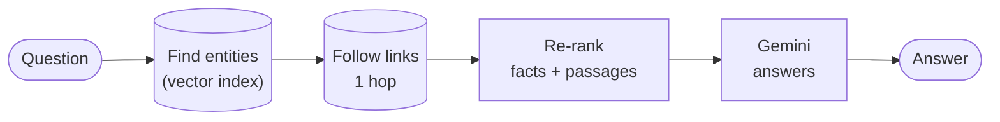

# 2 · GraphRAG: follow the links

In one sentence

Find the people, places and events the question mentions in an AI-built map of relationships, follow their links one step out, and answer from what's there.

The classic "GraphRAG" pattern · 67% · about 4,000 tokens and 10 seconds per question

**Analogy:** instead of searching the library, you look up the subject in an encyclopedia index and follow its "see also" links.

## How it works

<ol class="rv-steps">
<li><b>Link entities.</b> <code>vector_search_entities</code> finds the 5 entities closest to the question, for example "2018 Winter Olympics" and "Biathlon".</li>
<li><b>Traverse one hop.</b> <code>entity_neighbors_1hop</code> follows <code>RELATED_TO</code> edges to neighbouring entities, and collects the passages that mention any of them.</li>
<li><b>Re-rank.</b> Keep the most relevant 6 relationship facts and 5 passages.</li>
<li><b>Answer.</b> One Gemini call over those facts and passages.</li>
</ol>

The relationship map was built by Gemini reading every article (about 1,600 calls) and listing who and what is connected. See [the graph, layer 1](../graph.md#layer-1-text-and-entities-for-search).

## Example

> **"In the 2018 Winter Games, how many biathlon events drew a field larger than 73 athletes?"** Correct answer: 5. *(Our live run.)*

The links from "2018 Winter Olympics" and "Biathlon" led to passages about a few events, not all 11. It answered **2** ✕, the same mistake as plain search, reached a different way.

## Why it doesn't beat plain search here

- **It follows a fixed recipe.** If step 1 anchors on the wrong entity, steps 2–4 carry on with the wrong evidence. Nothing checks.
- **A popular entity has hundreds of links.** "2018 Winter Olympics" connects to thousands of things, so the traversal has to be capped (8 neighbours, 8 passages), and the cap decides what Gemini sees, not relevance.
- **The AI-built map stores relationships as sentences**, such as "won gold medal at", not as countable fields. "More than 73 competitors" isn't something it can filter on.

The team's first version, before re-ranking was added, scored **15%**. Re-ranking lifted it to parity with plain search.

## Numbers

| | Submitted | Our rerun |
|---|---:|---:|
| Exact match | 67 / 100 | 67 / 100 |
| Counting questions | 0 / 21 | 1 / 21 |
| Tokens per question | 3,952 | 3,982 |
| Seconds per question | 10.2 | 9.3 |

Our entity map came from a fresh Gemini extraction, so it is not identical to the team's. The score still landed on 67.

Code: `src/pipelines/graphrag/pipeline.py`
