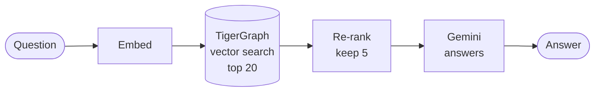

# 1 · RAG: plain search

In one sentence

Find the passages that sound most like the question, hand the best five to Gemini, and let it answer from them.

The baseline every other approach is measured against · 67% · about 3,600 tokens and 7 seconds per question

**Analogy:** searching a library catalogue, pulling the five books at the top of the results, and answering from just those.

## How it works

<ol class="rv-steps">
<li><b>Turn the question into numbers.</b> A local model (BGE) converts it into a 768-number "meaning fingerprint".</li>
<li><b>Vector search in TigerGraph.</b> <code>vector_search_chunks</code> returns the 20 passages whose fingerprints are closest.</li>
<li><b>Re-rank.</b> A second local model re-scores those 20 against the question and keeps the best 5.</li>
<li><b>Answer.</b> One Gemini call: "answer this question using only these passages, and cite them".</li>
</ol>

## Example

> **"In the 2018 Winter Games, how many biathlon events drew a field larger than 73 athletes?"** Correct answer: 5. *(Our live run, against our graph.)*

The search returned passages from a handful of biathlon articles. Gemini found two events with fields over 73 among them (men's sprint, 87; mixed relay, 80) and answered **2** ✕, with no way of knowing it had never seen the other event articles. On the eval's own wording of this question, the submitted run answered **1**: a different handful of passages, the same failure.

## Where it works, and where it doesn't

| Works well | Struggles |
|---|---|
| **Lookups:** 19/19. The answer sits in one article, and search finds it. | **Counting:** 1 of 21. It needs every event, and search returns five passages. |
| **"Games before X" questions:** 21/22 | **"Which was biggest":** 4 of 10, for the same reason |
| Cheap, fast, and needs no special data modelling | Sounds equally confident when it has only seen part of the evidence |

## Numbers

| | Submitted | Our rerun |
|---|---:|---:|
| Exact match | 67 / 100 | 67 / 100 |
| Tokens per question | 3,586 | 3,581 |
| Seconds per question | 6.8 | 7.1 |
| Found the right articles (precision / recall) | 0.43 / 0.73 | 0.43 / 0.73 |

Code: `src/pipelines/rag/pipeline.py`
