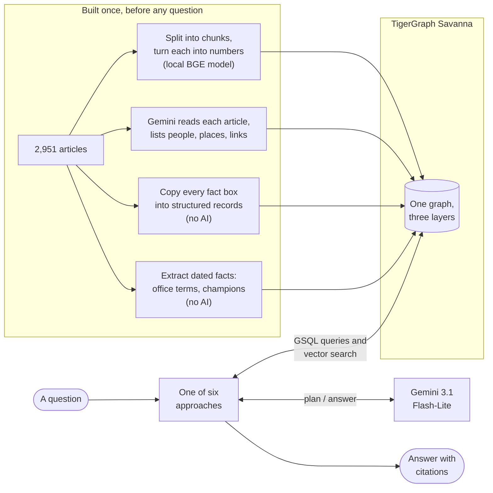
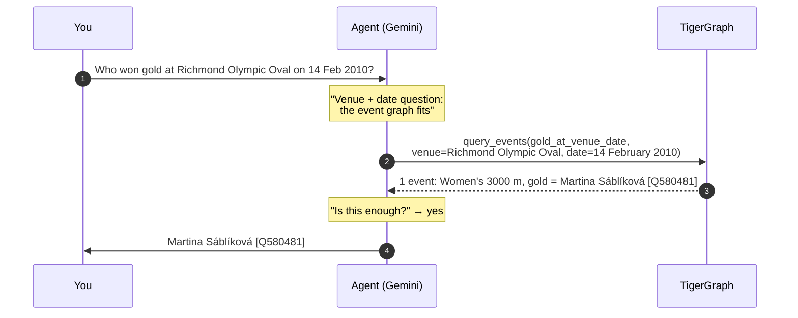

# How it works

Three moving parts: TigerGraph holds the knowledge, Gemini plans and writes, and small local models turn text into searchable numbers. Everything else is Python glue.

## The big picture

## The parts

| Part | What it does here | Notes |
|---|---|---|
| **TigerGraph Savanna 4.2.5** | Stores everything: articles, text chunks, entities, Olympic events, dated facts. Runs graph queries (GSQL) and **vector similarity search** natively. | No separate vector database. Search and traversal happen in one system. |
| **Gemini 3.1 Flash-Lite** | Plans which query to run, decides when evidence is enough, and writes the final answer. At build time it also reads every article to extract entities. | The same model for every approach, so the comparison is fair. A different Gemini model acts as the judge. |
| **BGE-base (local)** | Turns text into a list of 768 numbers that captures its meaning, so "similar meaning" becomes "nearby numbers". | Runs on the laptop. Free, no quota. |
| **BGE reranker (local)** | Re-sorts search results so the most relevant chunks go to Gemini first. | Cut token use roughly 3× in the team's tests. |
| **Python pipelines** | Six approaches, each a different strategy for using the parts above. | `src/pipelines/` |
| **Console** | A web UI to ask live questions, browse results, and run graph queries. | `src/dashboard/app_v2.py` ([screenshots](try-it.md)) |

## What happens when you ask a question

The submitted approach, *Agentic GraphRAG*, works like this for "Who won gold at Richmond Olympic Oval on 14 February 2010?":

That took **2 Gemini calls, 1 TigerGraph query, about 8 seconds and about 2,900 tokens**. The citation `[Q580481]` links to the source article, so every answer can be checked. The [approaches section](approaches/index.md) walks through each strategy the same way.

## How the graph is built

Run once, in this order. It took us a few hours, mostly waiting on Gemini during step 5.

| # | Step | What it does | Uses AI? |
|---:|---|---|---|
| 1 | `create_schema` | Creates the vertex and edge types, plus vector fields on chunks and entities | No |
| 2 | `fix_related_to_discriminator` | Rebuilds the entity-to-entity edge so two entities can have several different relationships | No |
| 3 | `create_queries` | Installs the vector-search and traversal queries | No |
| 4 | `load_documents_chunks` | Splits 2,951 articles into 14,332 chunks, embeds each locally, loads them | Local model only |
| 5 | `run_extraction_batch` | Gemini reads every article and lists entities and relationships | **Yes**, about 1,600 Gemini calls |
| 6 | `build_entities_graph` | Merges duplicate entities, embeds them, loads entities and links | Local model only |
| 7 | `build_event_graph` | Copies 2,210 fact boxes into structured event records; installs event queries | No |
| 8 | `build_temporal_facts` | Extracts 2,316 dated facts (office terms, reigning champions); installs fact queries | No |

!!! info "The 99% layer needs no AI to build"
    Steps 7 and 8, which power the most accurate approaches, are plain parsing: no AI, so the same output every time. Only the entity layer (step 5) depends on Gemini, and only the weaker approaches lean on it.
