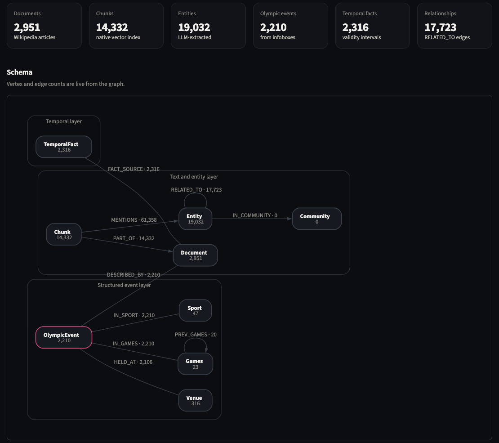

# The knowledge graph

<p class="lead">One TigerGraph graph with three layers, built three different ways. The layer that matters most is also the simplest: the article fact boxes, stored as structured records.</p>

<figure class="rv-shot" markdown>

<figcaption>The schema in our Savanna workspace, as drawn by the console's Graph page. Counts are live from the graph.</figcaption>
</figure>

## Layer 1: text and entities (for search)

**What it holds.** Every article (`Document`), split into overlapping passages (`Chunk`). Each chunk carries a **768-number "meaning fingerprint"** (an *embedding*), so TigerGraph's built-in vector index can find passages that *mean* something similar to a question. On top of that sit the people, places and events Gemini found in each article (`Entity`), linked to each other (`RELATED_TO`) and to the chunks that mention them (`MENTIONS`).

**How it was built.** Chunks are embedded locally. Entities come from Gemini reading every article: about 1,600 calls and roughly 11 million tokens. Because an AI wrote it, rebuilding it gives a *similar* entity graph, not an identical one.

| Vertex / edge | Count | In plain words |
|---|---:|---|
| `Document` | 2,951 | one per article |
| `Chunk` | 14,332 | a passage of an article, with its meaning fingerprint |
| `Entity` | 19,032 | a person, place, team or event Gemini found |
| `PART_OF` | 14,332 | chunk → the article it came from |
| `MENTIONS` | 61,358 | chunk → an entity it names |
| `RELATED_TO` | 17,723 | entity ↔ entity, with a label like "won gold medal at" |
| `Community` | 0 | in the schema, never used |

**Used by:** RAG, GraphRAG, the agent without graph tools, and the agentic approach's fallback search.

## Layer 2: the structured event layer (for exact answers)

**What it holds.** One `OlympicEvent` record per fact box, **2,210 in total**, with typed fields:

| Field | Example |
|---|---|
| title | Speed skating at the 2010 Winter Olympics – Women's 3000 metres |
| games, sport, venue | 2010 Winter · Speed skating · Richmond Olympic Oval |
| date | 14 February 2010 |
| competitors, nations | 28 · 13 |
| gold | Martina Sáblíková |

Each event links to its `Games`, `Sport` and `Venue`, and back to its source `Document`. `Games` vertices are chained by `PREV_GAMES` in calendar order, so "the Games immediately before 2016" is a single hop.

**How it was built.** Plain parsing of the fact boxes, with no AI. It is the same output every time and took seconds.

**Used by:** the event graph and Agentic GraphRAG approaches, the two that reach 99%.

!!! example "Why this layer changes everything"
    With fact boxes as records, "how many biathlon events at the 2018 Winter Games had more than 73 competitors?" stops being a reading exercise and becomes a filter, like the filter button in a spreadsheet.

## Layer 3: dated facts (for "as of" questions)

**What it holds.** 2,316 `TemporalFact` records, each true **for a time window**:

> *Vladimir Putin* — held office — *President of Russia* — valid from 7 May 2012

These come from politicians' fact boxes (term start and end) and from Olympic events held across several Games (the reigning champion holds the title until the next Games). Each fact links to its source article (`FACT_SOURCE`). If two sources disagree about the same window, the query returns both rather than silently picking one.

**How it was built.** Plain parsing, no AI.

**Used by:** Agentic GraphRAG's `query_facts` tool, for example "Who was the President of Russia on 1 January 2013?". The 100-question eval barely tests this layer. It is groundwork for the next round of the challenge.

## The queries that run on the graph

Eight GSQL queries are installed on the graph. The approaches call them over TigerGraph's REST endpoint.

| Query | What it does, in plain words | Used by |
|---|---|---|
| `vector_search_chunks` | find passages whose meaning is closest to the question | RAG, agents |
| `vector_search_entities` | find entities closest to the question | GraphRAG, agents |
| `entity_neighbors_1hop` | from those entities, follow links one step out and collect the passages that mention them | GraphRAG, agents |
| `events_by_games_sport` | every event of one sport at one Games, optionally above a competitor count | event graph, Agentic GraphRAG |
| `events_at_venue` | every event held at a venue | event graph, Agentic GraphRAG |
| `events_in_previous_games` | the same sport's events at the Games before the given one | event graph, Agentic GraphRAG |
| `facts_as_of` | dated facts that were true on a given day | Agentic GraphRAG |
| `fact_timeline` | every time window of a fact, in order | Agentic GraphRAG |

Here is the query behind the counting questions, lightly simplified, with notes in plain English (full version in `src/ingestion/build_event_graph.py`):

```sql
CREATE QUERY events_by_games_sport(VERTEX<Games> games, VERTEX<Sport> sport, INT min_competitors = -1) {
  InGames = SELECT e FROM OlympicEvent:e -(IN_GAMES)- G:g;   -- every event at these Games
  InSport = SELECT e FROM OlympicEvent:e -(IN_SPORT)- S:s;   -- every event in this sport
  Pool    = InGames INTERSECT InSport;                       -- both: 11 biathlon events in 2018
  Over    = SELECT e FROM Pool:e
            WHERE e.competitors > min_competitors;           -- more than 73: 5 events
  PRINT Pool; PRINT Over;
}
```

## Search vs. exact query

This is the distinction the rest of the review hinges on.

| | **Similarity search** (layer 1) | **Exact query** (layers 2 and 3) |
|---|---|---|
| Asks | "Which passages *sound like* the question?" | "Which records *match these conditions*?" |
| Looks at | the top 5–20 passages | every matching record |
| Who produces the answer | Gemini, reading whatever came back | the database, then Gemini phrases it |
| Same answer every time? | no | yes |
| Good for | open-ended questions, anything worded in prose | counting, ranking, filtering, "as of" dates |
| Weakness | silently misses records outside the top few | only answers what the records hold |
