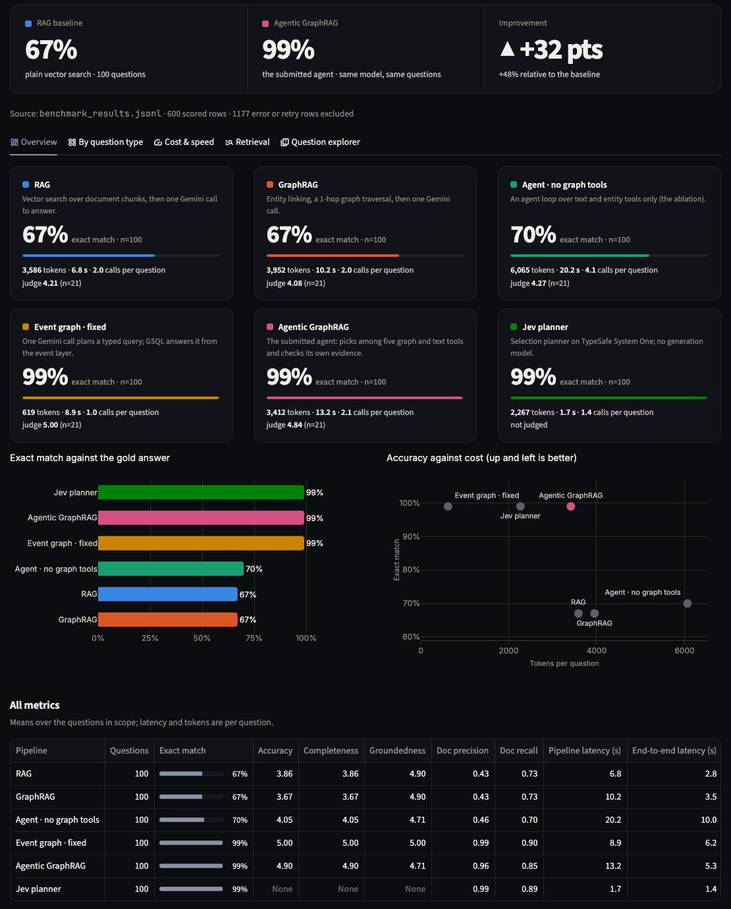
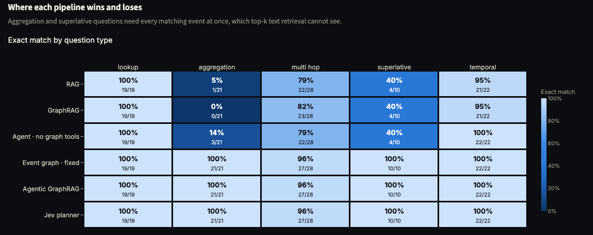

# Results

The structured graph is worth about 30 points; the agent on its own is worth about 3. Every number below was reproduced independently within one question.

<figure class="rv-shot" markdown>

<figcaption>The console's Benchmark page, showing the team's submitted results. A toggle switches every number to our rerun.</figcaption>
</figure>

## Headline: 100 public questions

| Approach | Exact match submitted | Exact match our rerun | Tokens / question submitted · ours | Seconds / question submitted · ours |
|---|---:|---:|---:|---:|
| RAG | 67% | 67% | 3,586 · 3,581 | 6.8 · 7.1 |
| GraphRAG | 67% | 67% | 3,952 · 3,982 | 10.2 · 9.3 |
| Agent without graph tools | 70% | 70% | 6,065 · 6,367 | 20.2 · 17.8 |
| Event graph | 99% | 99% | 619 · 588 | 8.9 · 6.5 |
| **Agentic GraphRAG** | **99%** | **98%** | 3,412 · 3,575 | 13.2 · 13.2 |
| Jev planner | 99% | not run | 2,267 · — | 1.7 · — |

Same corpus, same questions, same model (Gemini 3.1 Flash-Lite) for every approach. "Tokens" counts the approach only, not the AI judge.

## By question type

This is where the story is. Search-based approaches fail on **counting** and **"which was biggest"**, the two types that need every matching event at once.

| Approach | Lookup (19) | Multi-hop (28) | Temporal (22) | Superlative (10) | Aggregation (21) |
|---|---:|---:|---:|---:|---:|
| RAG | 19 | 22 | 21 | 4 | **1** |
| GraphRAG | 19 | 23 | 21 | 4 | **0** |
| Agent without graph tools | 19 | 22 | 22 | 4 | **3** |
| Event graph | 19 | 27 | 22 | 10 | **21** |
| Agentic GraphRAG | 19 | 27 | 22 | 10 | **21** |
| Jev planner | 19 | 27 | 22 | 10 | **21** |

<small>Submitted results. Our rerun differs by at most one question per cell.</small>

<figure class="rv-shot" markdown>

<figcaption>The same data as a heatmap in the console. Dark cells are where search-based approaches break down.</figcaption>
</figure>

The single multi-hop miss for the top three is a genuinely ambiguous question: two events were held at the same venue on the same day, and naming both counts as wrong.

## Cost and speed

- **Agentic GraphRAG costs about the same as plain search** (3,400 vs 3,600 tokens per question) for 99% instead of 67%. It takes about twice as long (13 s vs 7 s), because it makes two Gemini calls instead of one.
- **The event graph is the cheapest by far**, at about 600 tokens and one Gemini call. A fixed recipe on structured data needs very little model work.
- **The agent without graph tools is the most expensive and the least accurate of the agents.** More searching costs more and still can't see every record.

## The 50 hidden questions

Hidden questions have no published answers, so correctness was checked with the team's **fact-box checker**: a short script that works out each answer directly from the article fact boxes, with no AI and no database. On the 100 public questions it agrees with the official answers 99 times; the one exception is the ambiguous question above.

| Answers | Agree with the checker | Notes |
|---|---:|---|
| Agentic GraphRAG, as submitted (`hidden_50_results.json`) | 47 / 49 | both disagreements are formatting only: "Li Ting **and** Sun Tiantian" vs "Li TingSun Tiantian" |
| Agentic GraphRAG, our rerun | 47 / 49 | the same two formatting cases. **49 of 50 answers are identical to the submission.** |
| Event graph, our rerun | 49 / 49 | |

In substance, every checkable hidden answer is correct.

## Robustness checks

| Check | Submitted | Our rerun |
|---|---:|---:|
| **Reworded questions**: 10 questions rephrased to avoid the eval's wording, e.g. "Sydney 2000" instead of "the 2000 Summer Olympics", "biggest field" instead of "highest number of competitors" | 10 / 10 | 10 / 10 |
| **Regression tests**: six bugs that once cost accuracy, each pinned by a test | 6 / 6 pass | 6 / 6 pass |

## The AI judge (secondary)

A separate Gemini model scored 21 of the 100 answers (a 20% sample) from 1 to 5 for accuracy.

| | RAG | GraphRAG | Agent without graph tools | Event graph | Agentic GraphRAG |
|---|---:|---:|---:|---:|---:|
| Submitted | 3.86 | 3.67 | 4.05 | 5.00 | 4.90 |
| Our rerun | 3.76 | 3.48 | 3.86 | 5.00 | 5.00 |

Treat these as a rough signal. The sample is small, and on the team's first run this judge gave high marks to 14 answers that were wrong, mostly fluent "the corpus doesn't say" answers. That is why exact match is the headline.

## What to keep in mind

1. **The eval suits the design.** All 150 questions are five fixed shapes over fact-box fields, and the structured layer was built for exactly those fields. The reworded-question test shows it is robust to *wording*, but no question type outside the five was tested. A question the event layer can't express goes to text search, with text-search accuracy.
2. **The agent is mostly a smart router.** It chose the exact event query first on 100 of 100 questions and finished in two rounds on 93. Its value is picking the right tool, filling in the settings, and recovering when the tool comes back empty (7 questions).
3. **"Agentic GraphRAG" names a specific pipeline.** In the code it is `investigator`. The repo's original agent (`agentic`), which scores 70%, is presented as the ablation. Both are documented in the repo; the submitted 99% refers to the Investigator.
4. **Exact match is strict.** Two correct names joined differently can be marked wrong, and a data error in the source (the 41,000,000-competitor fencing event) becomes the "right" answer.
5. **The structured layer inherits the source's mistakes.** It copies fact boxes faithfully, typos included.
