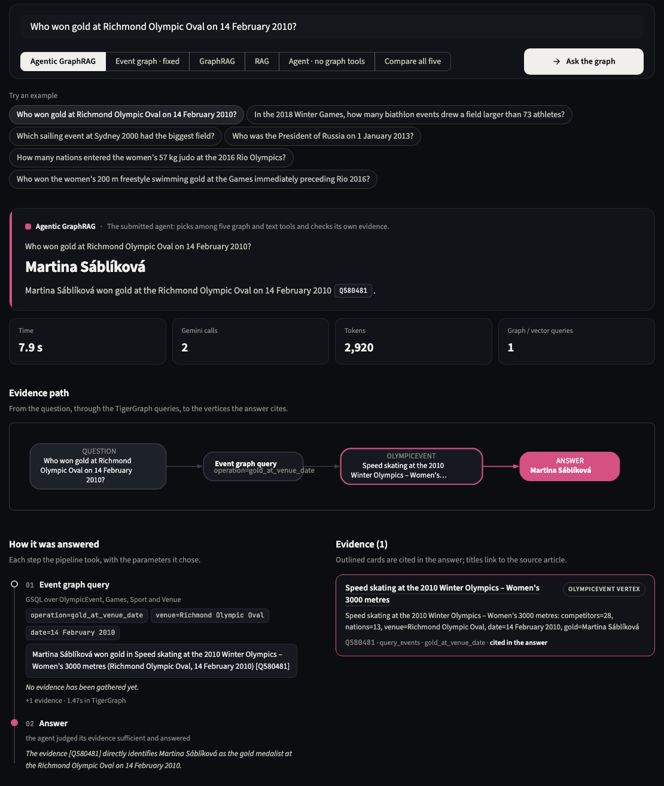
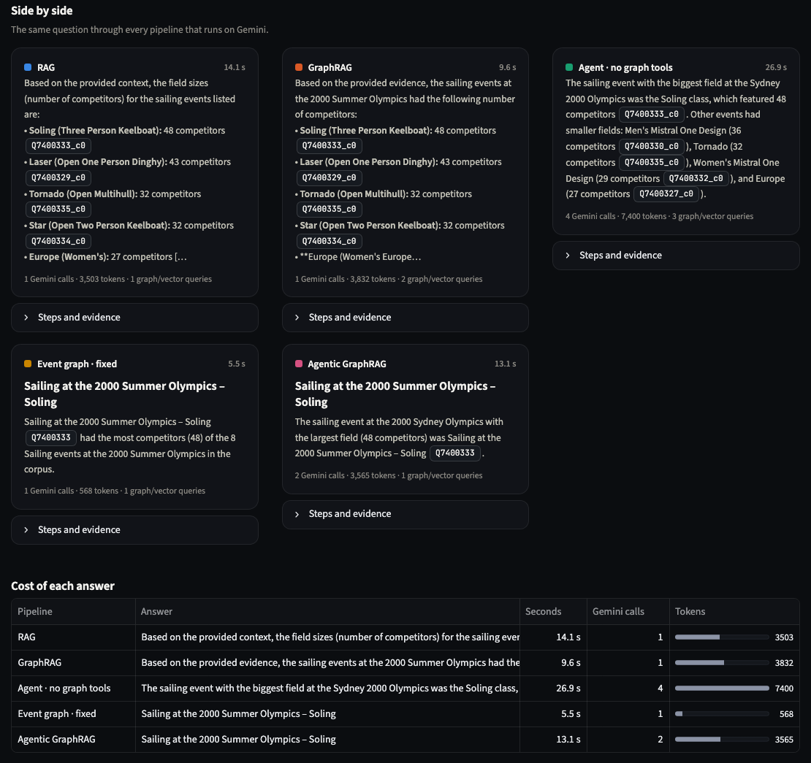
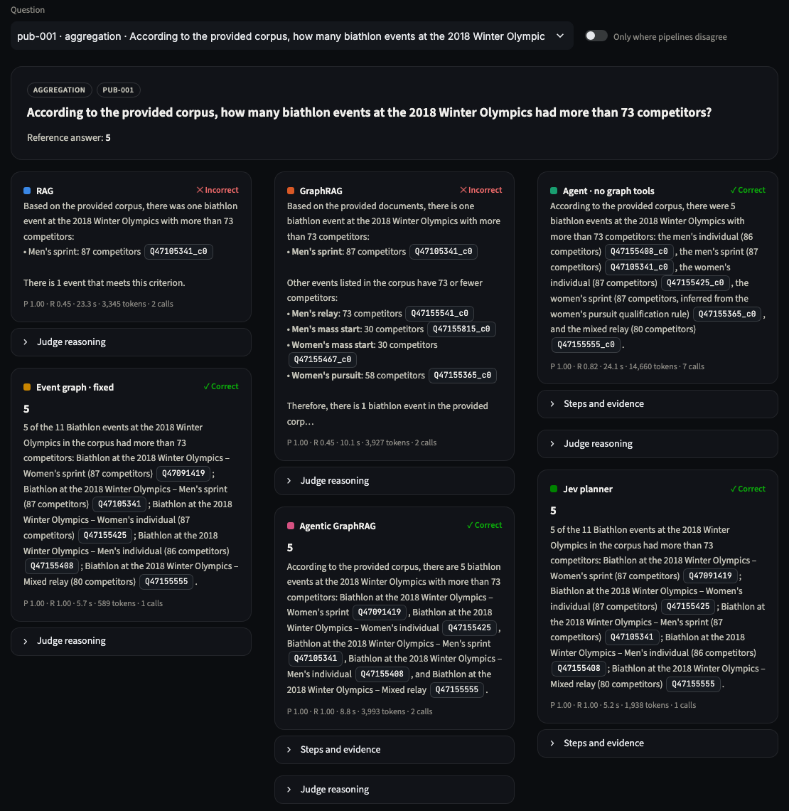
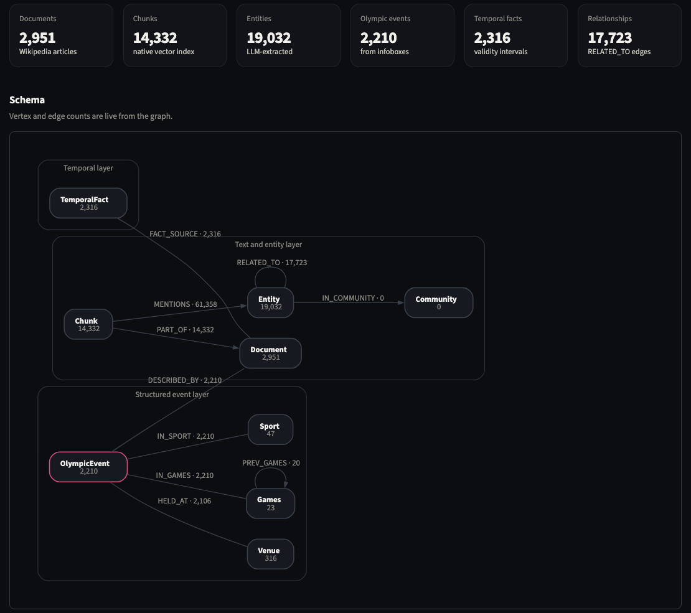

# Run it yourself

<p class="lead">Three ways in: a web console for asking questions and browsing results, a terminal command, and TigerGraph's own GraphStudio.</p>

## The console

A web app with three pages: **Ask** (live questions), **Benchmark** (all results, with a submitted/reproduced toggle) and **Graph** (schema plus a query runner).

=== "Ask a question"

    <figure class="rv-shot" markdown>
    
    <figcaption>One question, answered live. Below the answer: the evidence path through TigerGraph, each step the agent took, and the evidence it cited.</figcaption>
    </figure>

=== "Compare all five"

    <figure class="rv-shot" markdown>
    
    <figcaption>The same question through all five Gemini-based approaches, with the cost of each answer.</figcaption>
    </figure>

=== "Question explorer"

    <figure class="rv-shot" markdown>
    
    <figcaption>Any benchmark question with every approach's answer marked correct or incorrect, filterable to the questions where approaches disagree.</figcaption>
    </figure>

=== "Graph"

    <figure class="rv-shot" markdown>
    
    <figcaption>Live counts, the schema, and a runner for the eight installed GSQL queries.</figcaption>
    </figure>

## Setup (once)

You need a TigerGraph Savanna workspace (4.2.x) with an empty graph named `test` and a secret for it, a Gemini API key with billing enabled, and Python 3.11.

```bash
git clone <this repo> && cd agentic-graphrag-repro
python3.11 -m venv .venv && .venv/bin/pip install -r requirements.txt
cp .env.example .env    # then fill in TG_HOST, TG_SECRET, GOOGLE_API_KEY
```

Keep every other setting in `.env.example` as it is. They match the submission: Gemini 3.1 Flash-Lite, local BGE embeddings, reranker on.

## Build the graph (once)

```bash
python -m src.ingestion.create_schema
python -m src.ingestion.fix_related_to_discriminator   # missing from the README
python -m src.ingestion.create_queries
python -m src.ingestion.load_documents_chunks
python -m src.ingestion.run_extraction_batch            # the long, Gemini-heavy step
python -m src.ingestion.build_entities_graph
python -m src.ingestion.build_event_graph
python -m src.ingestion.build_temporal_facts           # missing from the README
```

!!! tip "Skip the expensive step"
    `data/results/extractions.jsonl` holds our finished Gemini extraction. If it is present, `run_extraction_batch` finds every article already done, skips about 1,600 Gemini calls, and you get our exact entity graph.

## Ask questions

=== "Console"

    ```bash
    .venv/bin/streamlit run src/dashboard/app_v2.py
    ```
    Open http://localhost:8501, type a question or click an example, and pick an approach or **Compare all five**.

=== "Terminal"

    ```bash
    .venv/bin/python scripts/ask.py "Who won gold at Richmond Olympic Oval on 14 February 2010?"
    .venv/bin/python scripts/ask.py --compare "Which sailing event at Sydney 2000 had the biggest field?"
    .venv/bin/python scripts/ask.py -p rag "..."     # rag · graphrag · agentic · event_graph · investigator
    .venv/bin/python scripts/ask.py                  # interactive: one question per line, blank line quits
    ```

=== "GraphStudio"

    In Savanna, open **GraphStudio → graph `test` → Write Queries**. All eight queries are installed there and can be run with parameters, with results drawn as a graph.

**Questions that work well** (the library is mostly Olympic events):

- *Who won gold at Richmond Olympic Oval on 14 February 2010?*: Martina Sáblíková
- *In the 2018 Winter Games, how many biathlon events drew a field larger than 73 athletes?*: 5
- *Which sailing event at Sydney 2000 had the biggest field?*: Soling
- *Who was the President of Russia on 1 January 2013?*: Vladimir Putin
- *Who won the women's 200 m freestyle at the Games immediately preceding Rio 2016?*: Allison Schmitt

## Rerun the benchmark

```bash
# Always pass --output: the default file already holds the team's results, and done questions are skipped.
python -m src.eval.run_benchmark --pipelines rag,graphrag,agentic,event_graph,investigator \
    --output data/results/my_run.jsonl
python -m src.eval.oracle data/results/repro_hidden_investigator.jsonl   # hidden-set check, no AI or database
python -m tests.test_regressions                                         # about a second, no AI or database
```

## Rebuild this site

```bash
.venv/bin/pip install mkdocs-material
cd docs-site && ../.venv/bin/mkdocs build      # writes docs-site/site/; open site/index.html
../.venv/bin/mkdocs serve                      # or browse at http://127.0.0.1:8000 with live reload
```
